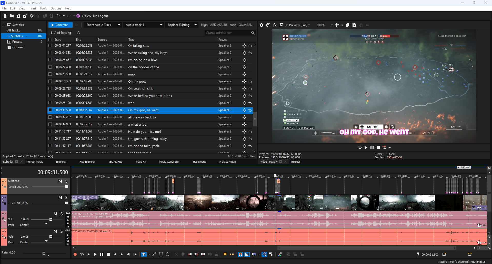
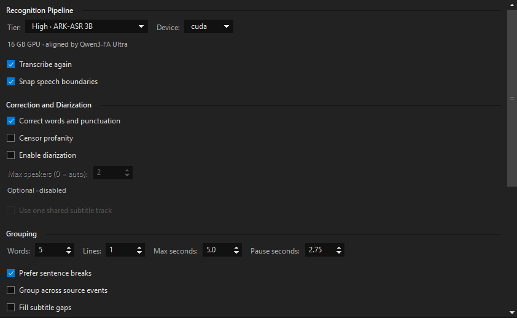
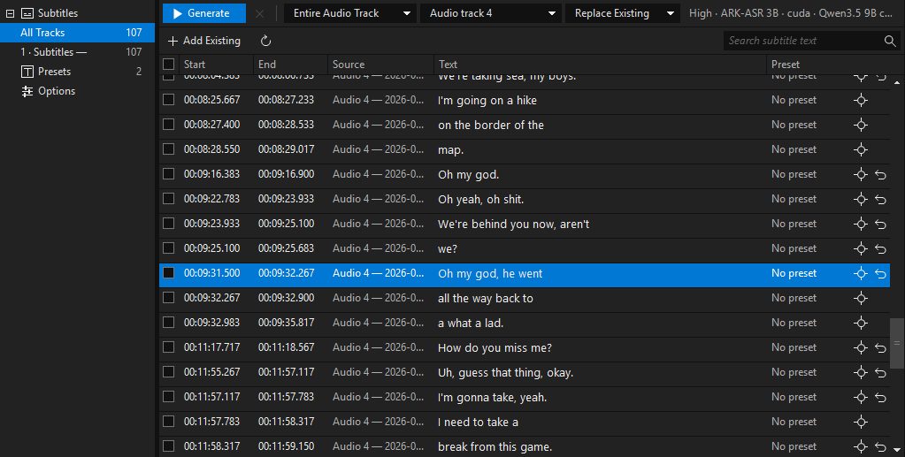
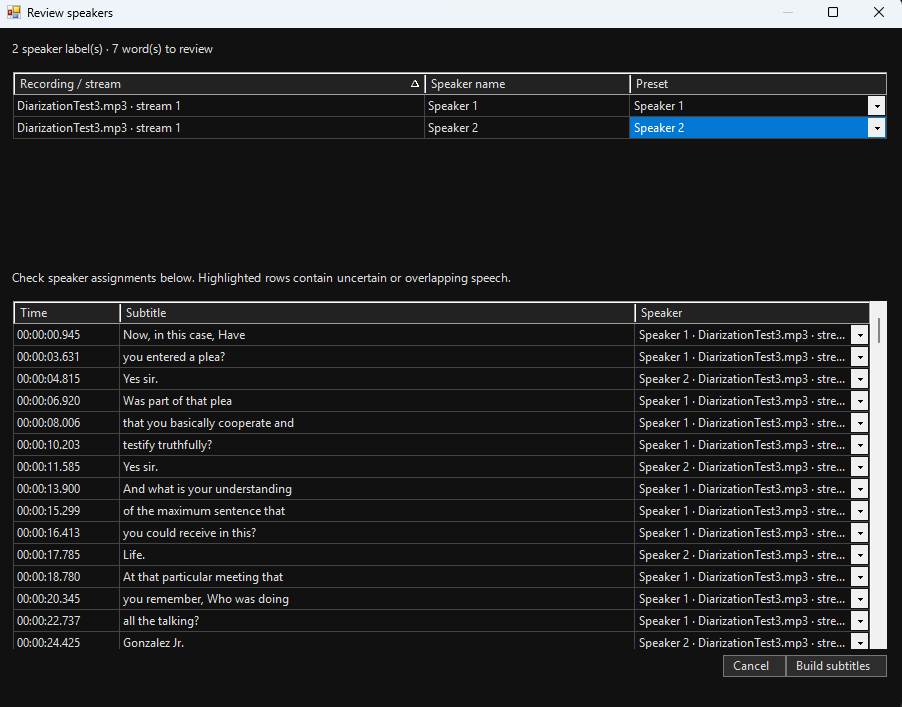
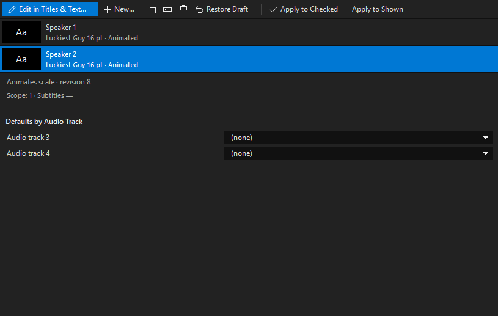
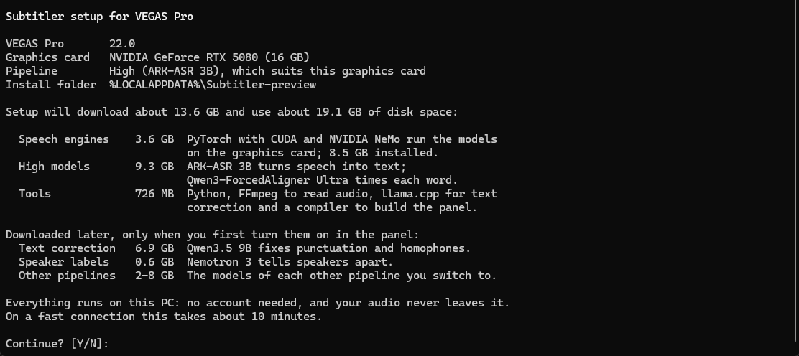

# BetterVegasProSTT

BetterVegasProSTT turns the speech on your VEGAS Pro timeline into subtitles: native Titles & Text events, timed to the word and styled with your own presets. Recognition runs entirely on your PC with open speech models. There is no account, and your audio never leaves your computer.

Note: This extension was made for `Vegas Pro 22.0 (Build 250)`. It may not work for other versions of Vegas!

## Features

### Subtitles from your timeline

- Select audio events, a single event or a whole audio track, then click **Generate**.
- Subtitles are regular Titles & Text events on their own video tracks, so you can trim, move and edit them like any other title.
- Word timing comes from a forced aligner, and word edges snap to where speech actually starts and stops.
- Timing matches how VEGAS itself plays compressed audio, so subtitles don't drift early or late on MP3, AAC or MP4 sources.
- High and Medium run a second pass that picks up quiet speakers ordinary speech detection misses.
- Set how subtitles are grouped: words and lines per subtitle, maximum length, pause length and sentence breaks. Optionally, fill the gaps between subtitles.

### Three recognition pipelines

Setup picks the pipeline that suits your graphics card. You can change it under **Options → Recognition Pipeline**.

| Pipeline | Recognizer | Made for |
| --- | --- | --- |
| High | ARK-ASR 3B | 16 GB+ graphics cards |
| Medium | Qwen3-ASR 1.7B | 8–12 GB graphics cards |
| Low | Parakeet TDT 0.6B v2 | 6 GB graphics cards, or the CPU |

Every pipeline times its words with Qwen3-ForcedAligner Ultra.

### Edit and review

- Edit wording directly in the subtitle list. The row under the playhead is highlighted as VEGAS plays.
- Search the text, filter by track, and **Locate** any subtitle on the timeline.
- Regenerate without losing your edits: **Keep and Suggest** places new wording under each subtitle for you to accept or keep, one at a time or in batches. **Replace Existing** asks first before replacing text you corrected.
- Bring Titles & Text events you made yourself into the list with **Add Existing**.

### Text correction (High pipeline)

- A local language model, Qwen3.5 9B, fixes punctuation, capital letters and sound-alike words ("there" for "their"). It never adds, removes or rephrases words, and timing stays the same.
- Corrected words are shown in blue, and **Revert Corrections** restores the original wording.
- **Censor profanity** replaces swear words with asterisks of the same length.

### Speaker labels

- NVIDIA Nemotron 3 tells up to eight speakers apart, even when they share one audio track.
- Before anything reaches the timeline, review the speakers: rename them, give each one a preset, and fix any subtitle's speaker.
- Each speaker gets their own subtitle track, or they can all share one.

### Presets

- Design a subtitle style in VEGAS's own Titles & Text window: font, colours, outline, shadow, position and animation.
- Apply it to checked or shown subtitles, or set a default preset for each audio track.
- Animation keyframes keep their timing, and can be scaled to fit shorter subtitles.

## Install

You need 64-bit Windows 10 or 11, VEGAS Pro 22 or newer, and an internet connection during setup. An NVIDIA graphics card (GeForce 20 series or newer) is strongly recommended; without one, recognition runs on the CPU and is much slower.

1. Close VEGAS Pro.
2. Double-click **Setup.cmd**. It shows what it will download and how much disk space it needs, and asks before it starts. No administrator rights are needed.
3. Open VEGAS Pro and choose **View → Extensions → Subtitler**.

| Pipeline | Download | Disk space |
| --- | --- | --- |
| High | 13.6 GB | 19.1 GB |
| Medium | 10.4 GB | 15.9 GB |
| Low | 8.3 GB | 13.9 GB |

- **Time:** setup takes about 10 minutes with a fast internet connection.
- **Optional downloads:** text correction (6.9 GB) and speaker labels (0.6 GB) download the first time you turn them on.
- **Install location:** everything goes into `%LOCALAPPDATA%\Subtitler`. **Options → Local Storage** shows the downloaded models and can delete them.
- **Update or repair:** run **Setup.cmd** again.
- **Remove:** run **Uninstall.cmd**.
- **VEGAS Pro versions:** BetterVegasProSTT is tested on VEGAS Pro 22. Setup also installs it into VEGAS Pro 23, which has not been tested yet.

## Building from source

**Setup.cmd** builds the panel from `src` with its own pinned C# compiler, so no .NET SDK or Visual Studio is needed. To compile the panel alone after setup, run `setup\Build.ps1`.

Check your file hashes! These are the file hashes of the compiled files, if your file hashes do not match these, remove them!

To check, run this command in powershell:
>  Get-FileHash -LiteralPath "C:\Users\username\AppData\Local\VEGAS Pro\22.0\Application Extensions\file name" -Algorithm SHA256

Subtitler.Core.dll (SHA256): `5F3DF0A996342C6757BFC2FA71FBA428A94DFFBC457CE8B132F1D024FCA6656D`

Subtitler.Vegas.dll (SHA256): `D331437BC82EEFF692DB4B64C7C62EBF8C655981234364D8D1DA338949E43B12`

## Disclaimer

BetterVegasProSTT is an independent project. It is not affiliated with, endorsed by or sponsored by the makers of VEGAS Pro, or by the developers of the speech models and tools it uses. VEGAS Pro and all other product names are trademarks of their respective owners, and are used here only to describe compatibility.

Setup downloads third-party software and AI models from their official sources. Each has its own license, which applies when you install it. BetterVegasProSTT is provided as is, without warranty of any kind.
